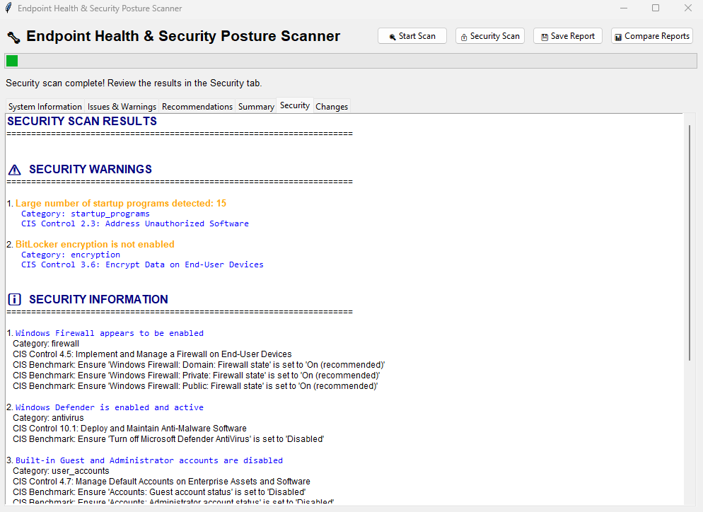

# Endpoint Health & Security Posture Scanner

  

A Python tool that audits a Windows, Linux, or macOS endpoint for system health problems and security misconfigurations. It maps each security finding to **CIS Controls v8** and the **CIS Microsoft Windows Benchmark**, turns findings into prioritized remediation steps, and tracks what changed between scans. It runs as a desktop GUI or a command-line tool and exports JSON or HTML reports.



## Why I built it

Managing device compliance for a 95-endpoint fleet taught me that most endpoint problems fall into two groups: a machine is running poorly, or a security control is quietly off. Enterprise tools such as Intune and an EDR platform catch these at scale, but a standalone machine has nothing comparable. I wanted one tool that checks both groups on a single machine, ties each security finding to the framework an auditor would cite, and says what to do about it.

## Highlights

- **10 security posture checks**, each mapped to CIS Controls v8 safeguards and, on Windows, to CIS Benchmark recommendations
- **Prioritized remediation.** Every finding comes with a severity level and concrete steps to fix it.
- **Scan comparison.** Shows what is new, worse, better, resolved, or unchanged between two scans.
- **Report export.** JSON for automation; standalone HTML for a browser, a printout, or a ticket attachment.
- **Tested.** 56 unit tests, using only the standard library, cover the recommendation engine and scan comparison.
- **Read-only and local.** Nothing leaves the machine, and no settings are changed.

## Security posture checks

| Check | What it looks at (Windows) | CIS Controls v8 |
| --- | --- | --- |
| Firewall | Domain, private, and public profile state (`netsh advfirewall`) | 4.5 |
| Antivirus | Microsoft Defender (`Get-MpComputerStatus`) and third-party products registered with Windows Security Center (`Get-CimInstance`) | 10.1 |
| Defender configuration | Real-time protection, antispyware, and last quick and full scan times | 10.1 |
| Disk encryption | BitLocker status (`manage-bde -status`) | 3.6 |
| Remote access | Remote Desktop configuration | 4.8 |
| User accounts | Whether the built-in Guest and Administrator accounts are enabled, found by well-known SID so renamed accounts are caught (`Win32_UserAccount`) | 4.7 |
| Network security | Shared folders and printers, ignoring the built-in administrative shares such as `C$` and `ADMIN$` (`Win32_Share`) | 3.3 |
| Startup programs | Programs set to launch at boot | 2.3 |
| Suspicious processes | Running processes that match suspicious patterns | 2.3, 10.1 |
| File permissions | Write access to sensitive directories | 3.3 |

On Windows, findings also list the matching CIS Benchmark recommendation, for example `Ensure 'Windows Firewall: Domain: Firewall state' is set to 'On (recommended)'`. Recommendations are listed by title rather than number, because benchmark numbering changes between releases. All mappings live in `cis_mapping.py`.

Linux and macOS are supported where an equivalent check exists, such as the UFW firewall.

## System health checks

| Check | Warning | Critical |
| --- | --- | --- |
| Disk space used | > 80% | > 90% |
| Memory used | > 80% | > 90% |
| CPU load | > 80% | > 90% |
| Temperature (where sensors exist) | > 70°C | > 80°C |
| Battery level (laptops) | < 30% | < 20% |

It also reviews resource-heavy processes, network connections, disk health, and the presence of critical system directories and files.

## Scan comparison

Compare two saved JSON reports to see what changed. Each problem is labeled **new**, **got worse**, **got better**, **resolved**, or **still present**.

Findings are matched on what they check, such as a disk's mountpoint, a file path, a temperature sensor, or the check itself. A disk going from 85% to 88% full therefore shows as one problem that got worse, not as one resolved and one new. Reports are put in date order automatically, and you get a warning if they come from different machines.

## Architecture

```
gui.py / main.py          Interfaces (Tkinter GUI, CLI)
      │
      ├── scanner.py           SystemScanner: health checks (psutil + PowerShell CIM)
      ├── security_scanner.py  SecurityScanner: security posture checks
      │     └── cis_mapping.py     Finding category → CIS Controls / Benchmark references
      ├── recommender.py       RecommendationEngine: findings → prioritized actions
      │                            └── Report export: JSON, or HTML via html_report.py
      └── scan_compare.py      Compares two saved JSON reports (also runs standalone)
```

**Design notes**
- Every scanner returns findings in one structure: a type (issue, warning, or info), a category, a message, and details. That shared structure is what lets the CIS mapping, recommendations, reports, and comparison all work from the same data.
- The recommendation engine is separate from the scanners, so new checks can be added without changing the interfaces.
- Windows checks use PowerShell CIM cmdlets (`Get-CimInstance`) instead of the deprecated `wmic`, which is disabled by default on recent Windows 11 builds.
- The GUI runs scans on a background thread so the window stays responsive.
- The HTML report escapes all scan data before rendering it, so a process or file name can't inject markup into the report.

## Requirements

- Python 3.7 or later
- `psutil`
- Administrator or root privileges for full results. Some checks, such as BitLocker and Defender, return limited data without elevation.

## Installation

```bash
git clone https://github.com/jflangtry75/Endpoint-Health-and-Security-Posture-Scanner.git
cd Endpoint-Health-and-Security-Posture-Scanner
pip install -r requirements.txt
```

## Usage

**GUI (recommended)**
```bash
python gui.py
```

| Button | What it does |
| --- | --- |
| **Start Scan** | Runs the system health checks |
| **Security Scan** | Runs the security posture checks with CIS mappings |
| **Save Report** | Exports results as JSON or as a standalone HTML report |
| **Compare Reports** | Compares two saved JSON reports and shows the results in the Changes tab |

Results appear in tabs: System Information, Issues & Warnings, Recommendations, Summary, Security, and Changes. Each finding is color-coded by severity.

**Command line**
```bash
python main.py
```
At the end of the scan, enter `y` to save a JSON report or `h` to save an HTML report.

**Compare two scans from the command line**
```bash
python scan_compare.py diagnostic_report_EARLIER.json diagnostic_report_LATER.json
```

On Windows, you can also double-click `run_gui.bat` or `run_cli.bat`.

## Sample output

```
SCAN RESULTS
  WARNINGS:
    1. Disk C:\ is 85.2% full (45.3 GB free)

RECOMMENDATIONS
  [MEDIUM] DISK_SPACE: Disk C:\ is 85.2% full (45.3 GB free)
    Free up disk space soon
      • Run Disk Cleanup
      • Review and delete unused files
```

A security finding in a saved JSON report:
```json
{
  "type": "warning",
  "category": "firewall",
  "message": "...",
  "details": {},
  "cis": {
    "controls_version": "CIS Controls v8",
    "controls": [
      { "id": "4.5", "title": "Implement and Manage a Firewall on End-User Devices" }
    ],
    "windows_benchmark": [
      "Ensure 'Windows Firewall: Domain: Firewall state' is set to 'On (recommended)'"
    ]
  }
}
```

## Testing

```bash
python -m unittest discover tests
```

The 56 tests need nothing beyond the standard library. They cover:
- every finding category
- severity thresholds, including their exact boundaries
- the exact message formats the scanner emits
- scan errors that carry no details
- scan comparison matching, ordering, and different-machine warnings
- the recommendation structure that the GUI, CLI, and HTML report depend on

## Safety and privacy

- **Local only.** The tool sends no data off the machine.
- **Changes nothing.** It reads system state and never modifies settings. The file-permission check reads folder access lists rather than test-writing files.
- **Contains machine details.** Saved reports include the hostname and system specifications, so review a report before sharing it.

## Known limitations

- **Windows Update check.** This check depends on the third-party `PSWindowsUpdate` module and is skipped when the module isn't installed.
- **Temperature and battery data.** These depend on hardware sensors and aren't available on every system.
- **Linux and macOS CIS mappings.** These platforms map to CIS Controls v8 only. Benchmark recommendations are Windows-only for now.

## Roadmap

- [ ] Add CIS Benchmark recommendations for Ubuntu and macOS
- [ ] Check Windows Update status without a third-party module
- [ ] Run tests automatically with GitHub Actions
- [ ] Package as a standalone Windows executable

## License

MIT. See [LICENSE](LICENSE).

## Author

**Joseph F. Langtry**. Security engineer focused on identity, cloud security, and compliance. [LinkedIn](https://www.linkedin.com/in/joseph-langtry/)
